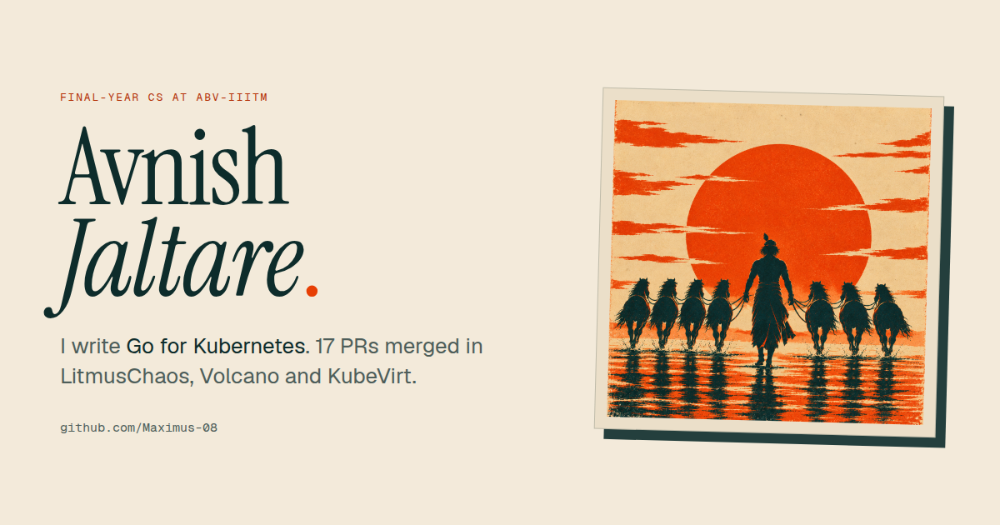

# Avnish Jaltare · portfolio

My personal site. I write Go for Kubernetes and contribute to CNCF projects like LitmusChaos, Volcano and KubeVirt. This repo is the source.



## What's on it

- **Journey.** My timeline drawn as a `git log --graph`. School and my own projects run on the main line, and open source branches off in January 2026.
- **Open source.** 17 merged PRs across LitmusChaos, Volcano and KubeVirt, led by the Job targeting feature that shipped as three PRs in three repos.
- **Work.** Underthehood, kb, my SEISAE 2026 paper and PromptZip, each with a small sketch of how it works.
- **Play.** Keep the cluster up, a 30 second chaos engineering game. A chaos monkey deletes pods and you reschedule them before the error budget runs out.
- **Two themes** taken from my avatar art. Paper and vermilion in light mode, a calm night palette in dark mode. The hero sun sets as you scroll.

## Stack

React 18, TypeScript, Vite, Tailwind CSS and Framer Motion. Fonts are Instrument Serif, Geist and Geist Mono. The timeline graph and the game are plain React and SVG with no extra libraries.

## Run it locally

```bash
npm install
npm run dev         # http://localhost:5173
npm run build       # production build in dist/
npm run typecheck
npm run lint
```

## Editing content

Everything the site says lives in [`src/data/profile.ts`](src/data/profile.ts). Components only render that data, so most updates touch one file.

- **New merged PR:** add it to `upstream`. Set `top: true` to show it on its project card. The totals in the hero update on their own.
- **New timeline entry:** add it to `journey`, newest first. `lane: 'oss'` puts it on the orange open source branch.
- **Now line:** update `profile.now` once a month.
- **Resume:** replace `public/Resume.pdf`.

## Layout

```
src/
  data/profile.ts      all content
  components/
    Hero.tsx           name, stats and the setting sun
    Journey.tsx        git graph timeline
    OpenSource.tsx     feature story and project cards
    Work.tsx           projects and their diagrams
    ChaosGame.tsx      the mini game
    Toolbox.tsx, Contact.tsx, Navbar.tsx, Footer.tsx
    ui.tsx             shared pieces: sections, reveal animation, avatar
  lib/theme.ts         light and dark toggle, follows the OS until you pick one
  index.css            theme colours as CSS variables
public/                resume, avatar, favicon and social preview image
```

## Contact

Email avnishjaltare8@gmail.com, or find me on [GitHub](https://github.com/Maximus-08) and [LinkedIn](https://www.linkedin.com/in/avnish-jaltare-508abb288/).
